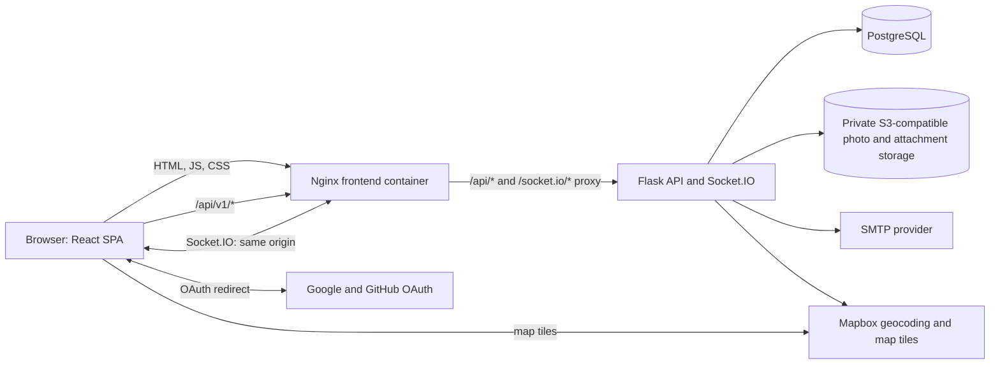

# Matcha Architecture

This document describes the implementation in this repository. The main application is a React single-page app backed by a Flask API, PostgreSQL, Socket.IO, and private S3-compatible object storage.

## System overview

In production, Nginx serves the built frontend and proxies API and Socket.IO traffic to Flask. The browser uses same-origin `/api/v1` requests, so it does not need a separate API URL. PostgreSQL stores application records and state; binary images and message attachments live in object storage.

## Technology stack

| Area              | Technology                                                     | Role                                                                                        |
| ----------------- | -------------------------------------------------------------- | ------------------------------------------------------------------------------------------- |
| Frontend          | React 19, TypeScript, Vite, React Router                       | Single-page application, client-side routes, development server, and production bundle      |
| UI                | HeroUI, Tailwind CSS 4, Lucide icons                           | Accessible UI primitives, utility styling, and icons                                        |
| Dates and time    | `@internationalized/date` and HeroUI date/time controls        | Date planning inputs and localized date handling                                            |
| Interactive map   | Mapbox GL JS                                                   | Map tiles, user markers, popups, and clustering                                             |
| Frontend realtime | Socket.IO client                                               | Notifications, presence refresh hints, typing indicators, and call signaling                |
| Backend           | Python 3.13, Flask, Flask-SocketIO, Gunicorn                   | HTTP API, WebSocket events, background delivery loops, and application serving              |
| Database access   | Psycopg 3 connection pool and handwritten SQL                  | PostgreSQL access without an ORM                                                            |
| Database          | PostgreSQL 17                                                  | Accounts, relationships, profiles, messages, notifications, dates, presence, and call state |
| Authentication    | Argon2, Authlib, protected OAuth state, opaque session cookies | Password authentication and optional Google/GitHub sign-in                                  |
| Image processing  | Pillow on the server; Canvas in the browser                    | Validate, normalize, crop, rotate, and filter uploaded photos                               |
| Object storage    | S3 API via boto3                                               | Private profile photos and message attachments                                              |
| Email             | Python SMTP client                                             | Verification, password reset, and email-change confirmation                                 |
| Local services    | Docker Compose, RustFS, Mailpit                                | Local PostgreSQL, S3-compatible storage, and email capture                                  |
| Verification      | pytest, Node test runner, Playwright                           | Backend, frontend utility, and browser-level coverage                                       |

## Repository layout

- `frontend/src/App.tsx` owns application startup, route selection, authentication state, top-level errors/toasts, and the shared realtime connection.
- `frontend/src/features/` contains feature areas: auth, profile, discovery, map, inbox/chat, activity, dates, and calls.
- `frontend/src/shared/` contains API access, shared types, navigation, theme, and common controls.
- `backend/app.py` configures Flask, database access, authentication helpers, error handling, security guards, and background loops.
- `backend/api/` contains route handlers grouped by auth, profiles, activity, and conversations/dates.
- `backend/domain.py` contains pure matching, distance, fame, age, and input-filter rules.
- `backend/schema.sql` defines the fresh-install relational schema. `backend/manage.py migrate` applies the baseline and incremental schema changes recorded in the `migrations` table.
- `compose.yaml` defines the production containers. `compose.dev.yaml` adds local-only RustFS and Mailpit services.

## Frontend and API boundary

The app routes include `/discover`, `/map`, `/activity`, `/messages`, `/dates`, `/settings`, and `/profile/:id`. `App.tsx` resolves these paths and renders the selected feature inside shared navigation.

`frontend/src/shared/api.ts` sends same-origin requests to `/api/v1`. It includes the session cookie, sends JSON or `FormData`, and adds the CSRF token to mutating requests. The backend returns structured JSON errors with an HTTP status, message, and optional field errors; the frontend turns these into field feedback or a page-level error.

The backend is a Flask application split into blueprints. Feature handlers call PostgreSQL through a shared Psycopg connection pool and issue parameterized SQL directly. There is no ORM. Pair-sensitive operations lock the two user rows in a stable order before changing relationship or conversation state.

## Data model

The primary records in `backend/schema.sql` are:

- `users`: credentials, verification state, names, birth date, gender, preferences, biography, tags, city and coordinates, last-seen time, and map visibility.
- `sessions` and `tokens`: login sessions and one-time verification, password-reset, and email-change tokens.
- `oauth_identities`: provider subject linked to a Matcha account.
- `photos`: user photo metadata, primary-photo flag, and ordered gallery position. Photo bytes are stored outside PostgreSQL.
- `likes`, `blocks`, `visits`, and `reports`: relationship and profile-safety actions.
- `messages` and `message_attachments`: message history and metadata for object-stored attachments.
- `notifications` and `muted_notifications`: durable activity records and notification suppression after an unlike.
- `presence`: expiring per-session/per-tab presence leases.
- `calls`: expiring audio/video call signaling state.
- `date_events`: date invitations and their pending, accepted, declined, or cancelled status.
- `request_limits` and `photo_deletions`: authentication throttling and retryable object cleanup.

Indexes support notification and message history, unread-message lookup, tag search, presence expiry, map visibility, OAuth identity lookup, and date/call queries.

## Authentication and security

Password registration validates email, username, names, and password quality. Passwords are stored as Argon2 hashes. A successful registration creates a one-time verification token and attempts delivery through SMTP. Password reset and email changes use expiring, single-use tokens; account-existence responses for reset requests are intentionally generic.

Login creates a seven-day opaque session token. Only its digest is stored in PostgreSQL. The browser receives it in an HttpOnly, SameSite cookie, with the Secure flag controlled by `COOKIE_SECURE`. Mutating authenticated API requests require the per-session CSRF token in `X-CSRF-Token`. Authenticated Socket.IO connections use the same session cookie.

Authlib OAuth strategies are registered for Google and GitHub only when each provider's client ID and secret are configured. OAuth state uses the Flask secret key. Google requires a verified email; GitHub requires a verified email. A provider identity is not silently linked to an existing password account with the same email.

Other protections include request validation, parameterized SQL, upload limits and content decoding, trusted-origin checks for mutating requests, authentication request rate limits, generic server errors, and security response headers. Photo reads are authenticated and blocked relationships cannot fetch each other's photos.

## Profiles, relationships, and safety

Profiles include personal details, preferences, biography, reusable interest tags, selected location, map visibility, and up to five photos. The first photo is primary; users can reorder, replace, delete, and choose the primary photo. Profile completion gates discovery until required matching fields are present.

A like requires both users to have a primary profile photo. A connection exists only when both users have liked one another and neither blocks the other. Removing a like breaks the connection and mutes subsequent notifications from the other person until they like again. Blocking removes both likes and prevents profile discovery, notification delivery, photo access, and conversation access. Reports are stored for review.

Viewing a profile records a visit. Repeated views within 30 minutes do not create another visit notification. The profile displays the user's fame score, mutual-interest/connection state, online state, and last-seen timestamp.

## Matching and discovery

Matching logic lives in `backend/domain.py` and `backend/api/profiles.py`.

### Eligibility

A suggested profile must be verified and have a compatible gender and preference in both directions: the candidate's gender must be in the viewer's preferences, and the viewer's gender must be in the candidate's preferences. Candidates without a birth date, location coordinates, biography, or tags are excluded. Self, blocked users, and users who blocked the viewer are excluded.

### Ranking

For the default “suggested” order:

1. Candidates whose city matches the viewer's city come first.
2. Within that group, shorter geographic distance comes first.
3. For equal distance, more shared tags come first.
4. For equal shared-tag counts, higher fame comes first.
5. User ID is the deterministic final tie-breaker.

Distance uses the Haversine formula over stored coordinates. Fame is calculated as `round(100 * incoming_likes / (incoming_likes + 10))`, producing a bounded score that grows with incoming likes.

### Filters and sorting

Discovery and advanced search share the backend filter parser. Filters include age range, radius in kilometers, fame range, minimum shared tags, exact city, name/username query, and selected tags. Selected tags are all required on a candidate. Results can be sorted by suggested rank, age, distance, fame, or shared-tag count, in either direction. Results are paged in groups of 24. The frontend stores filter/sort state in the URL so it can be shared or restored.

## Location and interactive map

The location editor supports browser GPS and manually selected cities/neighborhoods. Manual selections are resolved to coordinates server-side. Mapbox Geocoding is used for city search and validation; a bundled location catalogue supports existing selections. The user can turn map visibility off.

`GET /api/v1/map/users` returns at most 500 verified, map-visible users who satisfy the same mutual gender/preference compatibility and profile-completion constraints and are not blocked in either direction. The frontend renders their coordinates as Mapbox markers, clusters dense areas, and opens profile popups from individual markers. The map starts around the viewer's saved location and follows the current light/dark theme. Mapbox tiles require a browser public token configured at build time.

## Photo gallery and uploads

The profile editor supports drag-and-drop additions and reordering, up to five photos, primary-photo selection, deletion, and editing pending uploads. Browser Canvas applies crop, zoom, rotation, and a selected filter before upload. The server independently validates allowed image formats, byte size, and pixel count; applies EXIF orientation; strips metadata by re-encoding to JPEG; and bounds the stored image dimensions.

Photo and attachment bytes are stored in a private S3-compatible bucket. PostgreSQL stores object keys and metadata. Deletion is queued in `photo_deletions` and retried by a background cleanup loop so a transient object-store error does not leave an unrecoverable database state.

## Messaging and conversations

Messages are available only while the pair is mutually connected and unblocked. The API returns cursor-paginated history and supports idempotent message submission using a client-generated message ID. Messages are limited to 4,000 characters. Conversation history remains readable after a connection ends, but sending and typing require an active connection.

The inbox supports photo, document, and voice-message attachments. Uploads are limited to 8 MB; photos are normalized like profile images, voice uploads use an extension allowlist, and documents are downloaded as attachments instead of rendered inline. Attachment retrieval is authenticated. Bytes are stored in object storage, with metadata in `message_attachments`.

Message delivery uses REST polling rather than Socket.IO push: the active thread asks for messages after its latest ID every four seconds. Older history uses a `before` cursor. Typing indicators are Socket.IO events and expire on the receiving client after a short timeout.

## Realtime events, unread counts, and presence

The frontend maintains one authenticated Socket.IO connection from `App.tsx`. The backend joins it to a private room for the current session. Client heartbeats run every five seconds; the backend refreshes an expiring presence record, and presence is considered online while any valid session/tab lease exists. The lease expires after 20 seconds without refresh. On online/offline transitions, the backend emits a `presence:changed` hint to mutual, non-blocked connections. The frontend treats this as an invalidation hint and reloads authorized data through REST.

Notifications are persisted in PostgreSQL before delivery. A backend background loop checks pending rows approximately once per second, emits a Socket.IO notification event to each active session for the recipient, and marks the row delivered. The client then fetches the authorized notification before showing its toast. This keeps the event payload small and avoids trusting notification content sent over the socket. Muted or blocked relationships are filtered at delivery and when notifications are listed.

The top-level unread summary is refreshed periodically and after realtime invalidation hints. The activity view also refreshes on a five-second interval. Notifications cover profile views, likes, mutual matches, disconnections, messages, and date invitations/responses. The activity screen includes visitors, connections, received/sent interest, blocks, read/unread state, and paginated history.

**Realtime transport split:** Socket.IO carries presence hints, notifications, typing, and call signaling. Chat message bodies are fetched over REST polling; they are not broadcast as Socket.IO message events.

## Audio and video calls

Calls are allowed only for online, mutually connected users. The caller obtains local microphone/camera media in the browser and asks the backend to create a short-lived call record. Socket.IO delivers the incoming call, acceptance, WebRTC offer/answer, ICE candidates, and end/decline events to the other participant's active sessions. The browser's WebRTC peer connection carries the actual media directly between participants; the backend acts as the signaling relay, not a media server.

Ringing calls expire after 60 seconds. Active call records use a short lease renewed by the caller heartbeat and are removed on end/decline or expiry. The call popup provides audio/video state, local preview, mute/camera toggles, and end-call controls.

The current peer connection config uses Google's public STUN server and does not configure a TURN relay. Networks that require a relay may therefore fail to establish media even when signaling succeeds.

## Date planning

Connected users can create date invitations with a title, place, optional details, and a timezone-aware start time. The backend requires a date at least ten minutes in the future and no more than 90 days ahead. The invitee can accept or decline; either participant can cancel an open/accepted plan. The `date_events` row is the source of truth for status.

The profile date planner creates an invitation and closes on success. The Dates view presents Scheduled, Invitations, and Past filters, with actions appropriate to each state. Creating, answering, or cancelling a plan creates an activity notification; its toast links to the Dates view.

## API areas

All endpoints are under `/api/v1`.

| Area           | Representative endpoints                                                                                         | Purpose                                                               |
| -------------- | ---------------------------------------------------------------------------------------------------------------- | --------------------------------------------------------------------- |
| Authentication | `/auth/register`, `/auth/login`, `/auth/providers`, `/auth/<provider>`, `/auth/token`, `/auth/logout`            | Registration, login, OAuth, verification/reset tokens, and logout     |
| Profile        | `/me`, `/me/profile`, `/me/photos`, `/profiles`, `/profiles/<id>`, `/profiles/<id>/like`, `/profiles/<id>/block` | Profile editing, gallery, discovery, profile views, and relationships |
| Activity       | `/notifications`, `/me/activity`, `/me/summary`, `/tags`, `/locations`                                           | Notifications, activity history, unread counts, and suggestions       |
| Map            | `/map/users`                                                                                                     | Compatible and map-visible user coordinates                           |
| Conversations  | `/conversations`, `/conversations/<id>/messages`, `/attachments`, `/read`                                        | Inbox, message history, attachments, and read state                   |
| Dates          | `/dates`, `/conversations/<id>/dates`, `/dates/<id>/rsvp`, `/dates/<id>/cancel`                                  | Date invitation management                                            |
| Health         | `/health`                                                                                                        | Backend/database health check                                         |

## Running and deploying

### Local development

`make dev` starts PostgreSQL, RustFS, and Mailpit in Docker. `make backend-dev` runs the Python backend on the host and points it at those local services; `make frontend-dev` runs Vite on the host. The backend dev target activates `backend/.venv`, installs `requirements.lock` with pip, applies migrations, initializes storage, and starts Gunicorn.

`make dev-seed` loads 500 fictional demo profiles and photos for local evaluation. It fetches its demo images from Random User, so seeding requires network access. Do not run it against production data.

### Production containers

`make prod` builds and starts the production Compose stack: PostgreSQL, Flask backend, and Nginx-served frontend. The backend/frontend dependencies are installed in their Docker images. Production expects a pre-provisioned S3-compatible bucket and a real SMTP service; RustFS and Mailpit are development-only. Configuration is read from `.env.production`, which must stay out of Git. By default, the frontend binds to `127.0.0.1:8080` for use behind a TLS reverse proxy. `make prod-down` stops services without deleting persistent database data; `make prod-logs` follows container logs.

## Testing and implementation boundaries

Backend tests live in `backend/tests/`, frontend utility tests in `frontend/tests/`, and browser scenarios in `frontend/e2e/`. The frontend production build performs TypeScript project checks before bundling.

The production Compose file runs one backend container and configures Gunicorn with one worker and 50 threads. There is no Redis message queue or distributed Socket.IO adapter in the current stack; multi-instance realtime delivery would need shared Socket.IO coordination and background-delivery ownership. WebRTC currently has no TURN service, as noted above.
