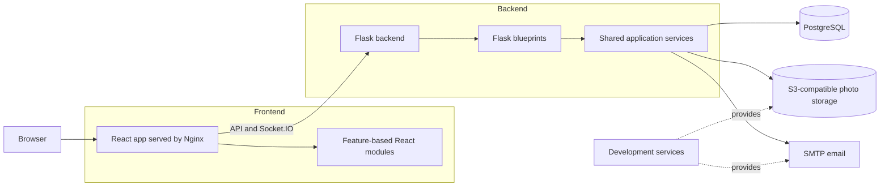

# Matcha

Matcha is a dating app for shared interests and meaningful connections. Build a profile, discover people nearby, and chat when interest is mutual.

## Run locally

You need Docker Compose. Copy the example settings, replace the placeholder DB password in both database settings, then start the app:

```sh
cp .env.example .env
# Set DB_PASSWORD and the matching password in DATABASE_URL in .env
make dev
make dev-seed  # Optional: add demo profiles
```

`make dev` starts only PostgreSQL, RustFS, and Mailpit. Run the app processes
in separate terminals with `make backend-dev` and `make frontend-dev`. The
frontend target installs its locked dependencies with pnpm before starting Vite.

Open the app at [http://localhost:8080](http://localhost:8080). The development inbox is at [http://localhost:8025](http://localhost:8025).

## Architecture



In development, RustFS provides photo storage and Mailpit provides the email inbox. `make dev-down` stops the services while preserving their data.
